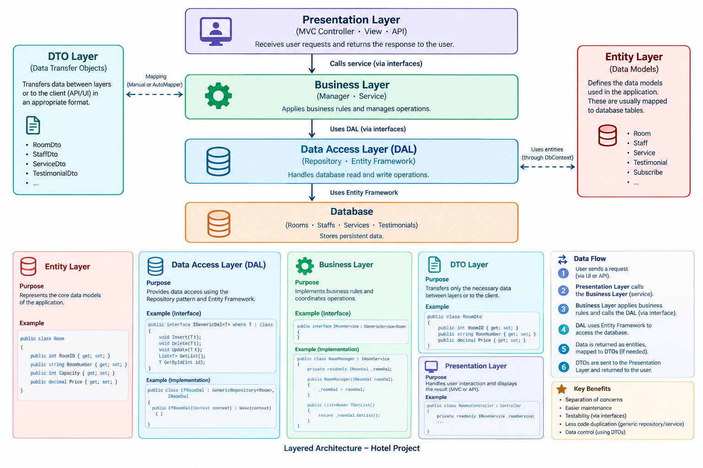

## Architecture



## Entity Framework Core Migrations

Use the following commands to create database tables and apply database changes.

### 1. Create an Initial Migration

```bash
dotnet ef migrations add InitialCreate
```

### 2. Create or Update the Database

```bash
dotnet ef database update
```

### 3. Create a New Migration

After modifying entities or database models, create a new migration:

```bash
dotnet ef migrations add UpdateDatabase
```

### 4. Apply Database Changes

Apply the newly created migration to the database:

```bash
dotnet ef database update
```

> **Note:** Run these commands from the directory containing the relevant `.csproj` file. If your solution contains separate projects for the data access layer and the startup application, specify the appropriate `--project` and `--startup-project` parameters.

## NuGet Packages

The project uses the following NuGet packages and versions.

### Entity Framework Core

| Package | Version | Projects |
|---|---|---|
| `Microsoft.EntityFrameworkCore` | 6.0.36 | All projects |
| `Microsoft.EntityFrameworkCore.SqlServer` | 6.0.36 | All projects |
| `Microsoft.EntityFrameworkCore.Tools` | 6.0.36 | All projects |
| `Microsoft.EntityFrameworkCore.Design` | 6.0.36 | All projects |

### AutoMapper

| Package | Version | Projects |
|---|---|---|
| `AutoMapper` | 12.0.0 | WebAPI, WebUI |
| `AutoMapper.Extensions.Microsoft.DependencyInjection` | 12.0.0 | WebAPI, WebUI |

### ASP.NET Core Identity

| Package | Version | Projects |
|---|---|---|
| `Microsoft.AspNetCore.Identity` | 2.3.13 | DataAccessLayer, EntityLayer, WebAPI, WebUI |
| `Microsoft.AspNetCore.Identity.EntityFrameworkCore` | 6.0.36 | DataAccessLayer, EntityLayer, WebAPI, WebUI |

